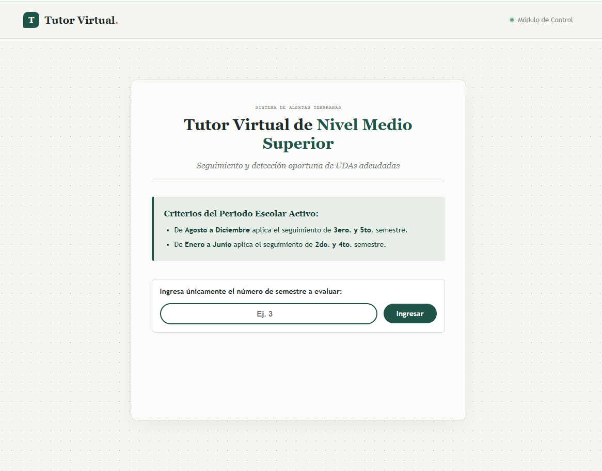
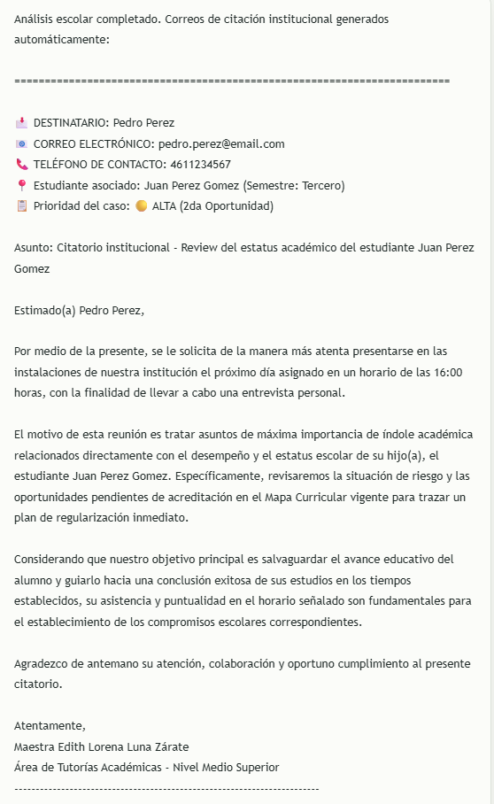
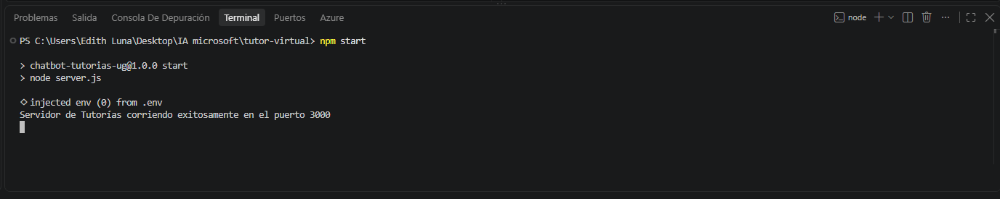

# Reporte Técnico del Proyecto: Asistente Virtual de Tutorías

## 1. Descripción del Problema Resuelto
## 1. Planteamiento y Explicación del Problema

La institución de Nivel Medio Superior analizada atiende a una matrícula promedio de 700 estudiantes distribuidos en 17 grupos (7 de primer semestre, 4 de tercero y 6 de mi quinto semestre) bajo una modalidad escolarizada presencial con un plan de estudios estructurado en 6 semestres. Este trayecto escolar se compone de 4 semestres de tronco común (40 materias) y 2 semestres de especialidad (20 materias). Aunque la normativa otorga un periodo de hasta 3 semestres adicionales para la regularización de unidades didácticas rezagadas (a través de recursamientos, cursos remediales intensivos de verano o invierno, y evaluaciones de regularización o preordinarias), la institución enfrenta un serio problema de bajo porcentaje en su eficiencia terminal debido al rezago acumulado y la deserción escolar.

El núcleo de la problemática se identifica en tres deficiencias operativas principales dentro del procedimiento administrativo actual:

* **Involucramiento Tardío o Nulo de los Padres de Familia:** Actualmente, la notificación de la situación académica en riesgo depende enteramente de que el estudiante entregue un citatorio físico a sus tutores legales. Ante el temor a represalias, muchos estudiantes omiten esta entrega. Esto ocasiona que las reuniones semestrales registren un índice de asistencia sumamente bajo, manteniendo a los padres desinformados hasta que el alumno se encuentra al borde de la baja definitiva.
* **Saturación y Desconexión en la Función Tutorial:** A pesar de contar con la figura de un tutor por grupo con una hora asignada por semana, el seguimiento académico manual es deficiente. Los tutores carecen de herramientas centralizadas y automáticas para procesar masivamente los historiales académicos (kardex) de los alumnos, lo que impide identificar oportunamente las trayectorias en riesgo antes de que se acumulen adeudos críticos.
* **Severidad de la Normativa y Pérdida de Matrícula:** El reglamento estipula que un estudiante solo cuenta con tres oportunidades consecutivas para aprobar cada unidad didáctica (ordinario presencial, regularización/curso intensivo y evaluación preordinaria). Al no existir un mecanismo de alerta temprana, los estudiantes agotan estas oportunidades y caen en un estatus de baja definitiva del sistema, el cual representa casi el 90% de la oferta educativa estatal, mermando gravemente la permanencia escolar.

Los principales desafíos abordados incluyen:
* **Falta de centralización:** Dificultad para procesar ágilmente los historiales y reportes de riesgo por semestre.
* **Comunicación tardía:** Retraso en la notificación e involucramiento de los padres o tutores legales sobre las incidencias académicas.
* **Carga administrativa:** Inversión excesiva de tiempo por parte de los coordinadores y tutores para generar citatorios individuales estructurados.

---

## 2. Explicación de la Solución Desarrollada
## 2. Solución Implementada y Arquitectura del Sistema

Para optimizar el seguimiento académico y elevar la eficiencia terminal, se implementó un nuevo procedimiento administrativo automatizado, soportado por un **Tutor Virtual con Inteligencia Artificial**. La solución elimina la dependencia de la entrega manual de citatorios y centraliza el análisis masivo de datos mediante una arquitectura de software ligera y de bajo costo basada en Node.js, Express y la carga digital de documentos en el Drive institucional.

La solución tecnológica se compone de los siguientes módulos funcionales:

### Componentes de la Arquitectura
* **Front-end Dinámico (Carpeta `public`):** Interfaz web limpia construida con HTML y CSS, diseñada para capturar el semestre y renderizar de forma interactiva la información generada por el chatbot sin recargar el navegador.
* **Servidor de Control (`server.js`):** Backend encargado de procesar las solicitudes de validación de semestres permitidos, filtrado de bases de datos de alumnos en riesgo académico (`alumnos_kardex.json`) y enrutamiento estructurado hacia el módulo de IA.
* **Agente Inteligente:** Modelo conversacional configurado con directrices estrictas de rol instruccional, capaz de desglosar historiales académicos (kardex) y estructurar las respuestas en viñetas ordenadas.
* **Módulo de Notificación Automatizada:** Plantilla integrada que genera de manera automática citatorios dirigidos específicamente a los padres o tutores del estudiante en riesgo, adjuntando canales directos de comunicación institucional.
[ Kardex Digitales en PDF (Drive) ] 
               │
               ▼
[ Servidor Express (server.js / ES Modules) ] ──(Consulta)──► [ Directorio de Padres (Base de Datos) ]
               │
               ▼ (Procesamiento de IA)
[ Reporte de Alertas e Histogramas ] ──(Automatización)──► [ Citatorios Profesionales y Canales Directos ]

---

## 3. Demostración y Capturas de Pantalla de la Aplicación

A continuación, se documenta la funcionalidad e interfaz del entorno desarrollado:

### Interfaz Web de Control
Pantalla inicial donde el usuario administrador ingresa el periodo o semestre a evaluar para desencadenar el análisis automático de riesgos de los alumnos.

### Interacción del Agente y Reporte del Chatbot
Vista del chatbot desplegando los datos de los estudiantes en riesgo de forma legible, estructurada mediante viñetas ordenadas y saltos de línea claros.

### Servidor Operativo en Consola
Evidencia del despliegue exitoso, encendido del servidor Express de Node.js de manera local en el puerto asignado.

---

## 4. Registro de Avances, Pruebas y Funcionalidades Implementadas

La documentación del desarrollo se mantuvo desde las primeras etapas del proyecto, registrando los siguientes hitos y pruebas de funcionamiento:

| Etapa / Funcionalidad | Descripción de la Prueba / Avance | Estado |
| :--- | :--- | :--- |
| **Diseño de Interfaz** | Estructuración del front-end adaptativo con HTML y CSS en la carpeta public. | **Completado** |
| **Lógica de Enrutamiento** | Validación del backend en `server.js` para recibir correctamente los semestres de Nivel Medio Superior. | **Completado** |
| **Integración de Base de Datos** | Lectura y filtrado correcto del archivo `alumnos_kardex.json` basado en el semestre consultado. | **Completado** |
| **Conexión con el Agente** | Pruebas de respuesta del chatbot con formato estructurado en viñetas limpias. | **Completado** |
| **Módulo de Notificación** | Verificación de la generación automática de la plantilla de citatorios para los padres o tutores. | **Completado** |

